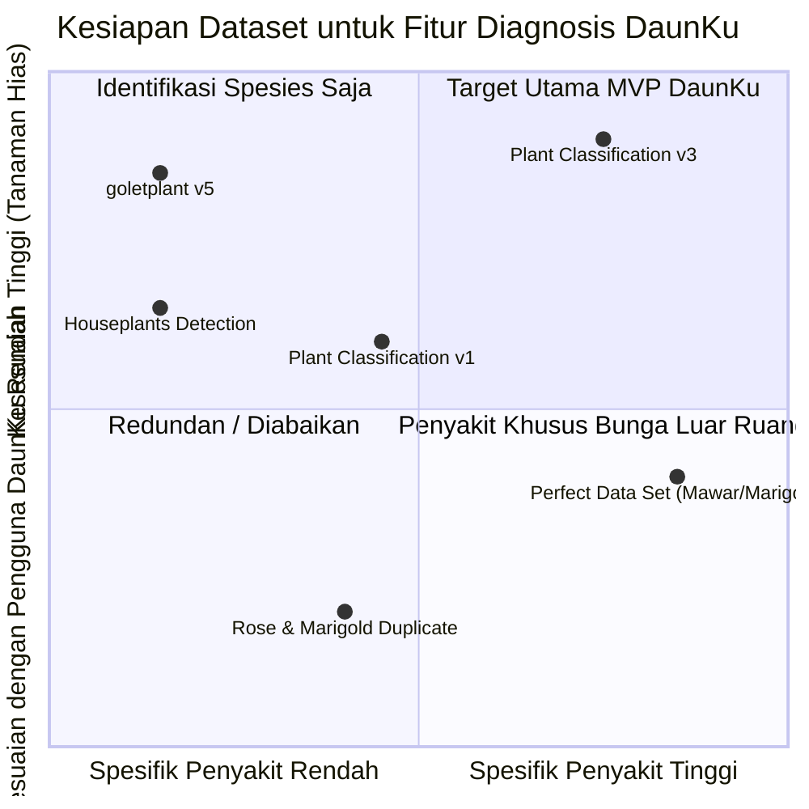

# DaunKu AI — Analisis Komprehensif Dataset & Rancangan Pengembangan Model AI

> **Status Dokumen:** Hasil Analisis Dataset dan Rancangan Awal AI  
> **Lokasi Target:** `daunku_ai/`  
> **Tanggal Analisis:** 21 November 2026  
> **Tujuan:** Memberikan evaluasi mendalam mengenai kekuatan, kelemahan, anomali, serta redundansi pada dataset yang tersedia di folder `daunku_ai/Dataset`, dan menyusun cetak biru (*blueprint*) pengerjaan AI untuk fitur diagnosis aplikasi DaunKu selaras dengan dokumen SRS dan SDD.  
> **Catatan Agent:** Dokumen ini bersifat analitis dan perancangan; tidak ada kode program yang diubah atau dijalankan sebelum rencana disetujui.

---

## 1. Inventarisasi dan Struktur Koleksi Dataset

Folder `daunku_ai/Dataset` memuat 6 folder repositori dataset komputer vision dengan total ukuran **~8.8 GB**. Berdasarkan ekstraksi metadata, anotasi CSV, dan struktur direktori, berikut adalah rincian inventarisnya:

| No | Nama Folder Dataset | Tipe Task & Format | Jumlah Gambar / Anotasi | Ukuran Disk | Fokus Konten |
| :---: | :--- | :--- | :--- | :---: | :--- |
| **1** | `goletplant.v5i.tensorflow` | Object Detection (Roboflow / TF CSV Bounding Box) | 26.063 gambar (41.587 bounding box) | 4.919 MB (~4,9 GB) | 52 spesies tanaman hias (*houseplants*) |
| **2** | `Houseplants Image Detection.v1i.tensorflow` | Object Detection (Roboflow / TF CSV Bounding Box) | 6.055 gambar (11.167 bounding box) | 321 MB | 24 spesies tanaman hias (*subset BibitUnggul Bangkit*) |
| **3** | `Plant Classification and Disease.v1i.tensorflow` | Object Detection (Roboflow / TF CSV Bounding Box) | 628 gambar (2.836 bounding box) | 34 MB | 10 tanaman hias + 4 kondisi penyakit |
| **4** | `Plant Classification and Disease.v3i.tensorflow` | Object Detection (Roboflow / TF CSV Bounding Box) | 3.206 gambar (11.326 bounding box) | 223 MB | 10 tanaman hias + 7 kondisi penyakit |
| **5** | `Perfect Data Set` | Image Classification (Direktori per kelas) | 3.449 gambar | 1.650 MB (~1,65 GB) | Penyakit Mawar (*Rose*) & Marigold |
| **6** | `Rose And MArigold Leaf Disease 1` | Image Classification (Direktori per kelas) | 3.449 gambar | 1.650 MB (~1,65 GB) | Duplikat persis dari `Perfect Data Set` |

---

## 2. Temuan Kritis: Redundansi, Duplikasi, dan Pembagian Split

Analisis hash dan nama file mendeteksi 3 temuan anomali kritis yang sangat berdampak pada efisiensi penyimpanan dan integritas pemodelan:

### 2.1 Duplikasi 100% pada Dataset Mawar & Marigold
* Folder `Rose And MArigold Leaf Disease 1` berisi subfolder `Perfect Data Set` yang **100% identik** dengan folder `Perfect Data Set` independen (keduanya memiliki 3.449 file dengan nama dan ukuran yang sama).
* **Dampak:** Membuang ruang penyimpanan sebesar **1,65 GB**. Jika kedua folder tidak disaring, risiko *data leakage* (data uji bocor ke data latih) sangat tinggi.

### 2.2 Hubungan Subset 100% Antar-Dataset Tanaman Hias
1. **`Houseplants Image Detection.v1i` vs `goletplant.v5i`:**
   * Seluruh **6.055 gambar** pada `Houseplants Image Detection` merupakan subset murni yang ada di dalam `goletplant` (memiliki nama file dasar yang sama).
2. **`Plant Classification and Disease.v1i` vs `v3i`:**
   * Seluruh **628 gambar** pada versi `v1i` sudah tercakup penuh di dalam versi `v3i` (3.206 gambar). Versi `v3i` merupakan pembaruan yang menambahkan kelas penyakit dan sampel baru.

### 2.3 Anomali Ekstrem pada Data Split (Train/Valid/Test) Roboflow
Pada beberapa dataset ekspor Roboflow yang ada, ditemukan ketidakseimbangan pembagian split yang parah:
* **`goletplant.v5i`:**
  * Train: **25.373 gambar** (97,3%)
  * Valid: **hanya 22 gambar** (0,08%) ⚠️
  * Test: 668 gambar (2,5%)
* **`Houseplants Image Detection.v1i`:**
  * Train: **5.967 gambar** (98,5%)
  * Valid: **hanya 4 gambar** (0,06%) ⚠️
  * Test: 84 gambar (1,4%)

> [!WARNING]
> Validasi model yang hanya menggunakan 4 atau 22 gambar tidak memiliki signifikansi statistik. Metrik validasi (akurasi/mAP) akan berfluktuasi liar (*overfitting* tidak terdeteksi). Dataset harus dipecah ulang (*re-split*) secara stratified sebelum *training*.

---

## 3. Analisis Mendalam Kelebihan & Kekurangan Tiap Dataset

### A. `Plant Classification and Disease.v3i.tensorflow` (Paling Relevan untuk DaunKu)
Dataset ini paling mendekati visi diagnosis DaunKu karena mengombinasikan **jenis tanaman hias** dan **kondisi/penyakit** dalam satu sistem anotasi kotak (*bounding box*).

* **Karakteristik & Kelas Anotasi:**
  * **Spesies Tanaman (10 Kelas):** *Aloe Vera* (1.985 box), *Monstera Deliciosa* (1.328 box), *Pothos / Epipremnum aureum* (917 box), *Tradescantia zebrina* (915 box), *Spider Plant* (888 box), *Rubber Fig / Ficus elastica* (686 box), *Snake Plant / Dracaena trifasciata* (671 box), *Alocasia Frydek* (392 box), *Aglaonema Commutatum* (327 box), *Dracaena angolensis* (158 box).
  * **Gejala / Penyakit (7 Kelas):**
    * `Unhealthy-Sunburn` (Terbakar sinar matahari) — 605 box
    * `Unhealthy-Rust` (Karat daun) — 460 box
    * `Unhealthy-Leaf-Curl` (Daun menggulung) — 380 box
    * `Unhealthy-Dehydration` (Kurang air / dehidrasi) — 321 box
    * `Unhealthy-Overwatering` (Kelebihan air / busuk akar awal) — 117 box
    * `Unhealthy-Mineral-Deficiency` (Defisiensi hara) — 87 box
    * `Unhealthy-Powdery-Mildew` (Embun tepung) — 69 box
  * Terdapat **622 gambar** yang memiliki anotasi ganda (*multi-label*): menandai tanaman sekaligus lokasi daun yang sakit.

* **Kelebihan:**
  * Sangat cocok dengan target pengguna DaunKu (pecinta tanaman hias *indoor*).
  * Meliputi masalah fisiologis non-parasiter (*sunburn, dehydration, overwatering*) yang paling sering dialami pemula merawat tanaman di rumah.
  * Resolusi seragam 640x640 siap pakai untuk arsitektur YOLO atau SSD/EfficientDet.

* **Kekurangan:**
  * *Class Imbalance:* Gejala kritis seperti *Powdery Mildew* (69 box) dan *Mineral Deficiency* (87 box) memiliki jumlah sampel yang sangat sedikit dibanding tanaman sehat.
  * Anotasi campuran: Beberapa gambar hanya dianotasi tanamannya saja tanpa melabeli kondisi daunnya secara spesifik.

---

### B. `goletplant.v5i.tensorflow` (Basis Pengenalan Spesies Tanaman)
* **Karakteristik:** 26.063 gambar dengan 52 varietas tanaman hias populer di Indonesia dan dunia (Monstera, Aglaonema, Alocasia, Anthurium, Philodendron, Sansevieria, Peperomia, Kaktus, Sukulen, dll.).
* **Kelebihan:**
  * Volume data sangat besar dan beragam.
  * Mencakup hampir semua tanaman hias komersial yang dijual di marketplace DaunKu.
  * Dapat berfungsi sebagai basis *Plant Identification* yang sangat akurat.
* **Kekurangan:**
  * **Murni identifikasi spesies, TIDAK ADA label penyakit/kesehatan tanaman sama sekali.**
  * Split validasi rusak (hanya 22 gambar).
  * Terdapat label kotor: label `-` dengan 3 anotasi kosong.

---

### C. `Perfect Data Set` (Mawar & Marigold)
* **Karakteristik:** 3.449 gambar klasifikasi daun per folder.
  * **Marigold (689 gambar):** *Alternaria Leaf Blight* (338), *Helathy Leaves* [sic] (273), *Pest Damaged* (78).
  * **Rose (2.760 gambar):** *Botrytis blight* (558), *Healthy* (1.167), *Pest Damage* (790), *Rose Mosaic Virus* (245).
* **Kelebihan:**
  * Resolusi tinggi (1080x1080 hingga 1434x1080).
  * Menghadirkan patogen spesifik (virus mozaik mawar, jamur *Botrytis*, dan *Alternaria*) serta serangan hama serangga (*pest damage*).
* **Kekurangan Kritis:**
  * **Artefak Latar Belakang Sintetis (*No Background Bias*):**
    * Seluruh 2.760 gambar Mawar adalah gambar `no_bg_*` (latar belakang dihapus/dipotong otomatis menggunakan software).
    * Seluruh gambar Marigold memiliki latar belakang nyata (*natural background*).
    * Model yang dilatih pada gambar tanpa latar belakang berisiko tinggi gagal (*generalization collapse*) saat diaplikasikan pada kamera pengguna smartphone yang memotret di taman dengan latar tanah/dedaunan lain.
  * Typo nama kelas: folder bertuliskan `Helathy Leaves`.
  * Belum memiliki split data (masih tercampur tanpa partisi train/val/test).

---

## 4. Keselarasan Terhadap Dokumen SRS & SDD DaunKu

Berdasarkan dokumen `SRS_DaunKu.pdf` dan `DaunKu_Rancangan_Pengembangan_Fitur.md`:

| Kebutuhan SRS / Dokumen | Kondisi pada Dataset Saat Ini | Status Kesiapan | Catatan Rekomendasi |
| :--- | :--- | :---: | :--- |
| **Cakupan Tanaman Hias:** Aglaonema, Monstera, Anthurium, Philodendron, Pothos, Alocasia, Snake Plant | Tersedia melimpah di `Plant Classification v3` dan `goletplant` | 🟢 **Sangat Siap** | Basis tanaman hias indoor sudah sangat kuat. |
| **Cakupan Tanaman Pekarangan:** Mangga, Jambu, Cabai, Tomat | **TIDAK ADA** pada dataset saat ini (hanya ada Bunga Mawar & Marigold) | 🔴 **Belum Tersedia** | Perlu diputuskan: batasi MVP hanya untuk Tanaman Hias & Bunga, atau tambahkan dataset publik (misal *PlantVillage* cabai/tomat). |
| **Diagnosis Penyakit & Masalah Perawatan:** Jamur, Hama, Masalah Air/Cahaya | Tersedia 7 kondisi di tanaman hias + 4 penyakit mawar/marigold | 🟡 **Cukup untuk MVP** | Sangat baik untuk mendeteksi *overwatering*, *sunburn*, dan *dehydration* yang paling sering ditanyakan pengguna. |
| **Rekomendasi Perawatan (KF-05):** Setiap hasil diagnosis wajib memuat saran tindakan | Dataset hanya menyediakan label gambar; teks rekomendasi belum ada | 🟡 **Perlu Knowledge Base** | Perlu dibuatkan tabel pemetaan *Disease ID -> Text Rekomendasi Medis/Perawatan* di backend. |
| **Response Time AI ≤ 15 detik (NFR-03)** | Model inference harus ringan dan cepat | 🟢 **Tercapai** | Model berbasis MobileNetV3, EfficientNet, atau YOLOv8-Nano/Small dapat inferensi <1 detik di server. |

---

## 5. Matriks Komparasi Kelebihan vs Kekurangan Dataset

---

## 6. Rancangan Solusi Arsitektur AI untuk DaunKu

Untuk menghasilkan fitur diagnosis yang andal di aplikasi Android, terdapat 2 pilihan arsitektur yang dapat diimplementasikan:

### Pilihan 1: *Two-Stage Cascaded Pipeline* (Sangat Direkomendasikan ⭐)
Pendekatan ini memisahkan tugas identifikasi jenis tanaman dan diagnosis kesehatan daun:
1. **Stage 1 (Plant Identification):**
   * Menggunakan model klasifikasi ringan (misal *MobileNetV3-Large* atau *EfficientNet-B0*) yang dilatih dari `goletplant` untuk mendeteksi jenis tanaman (Monstera, Aglaonema, Sansevieria, Mawar, dll.).
   * Jika skor keyakinan (*confidence*) < 60%, sistem menampilkan respons: *"Tanaman belum dikenali dalam cakupan DaunKu."* (Memenuhi syarat SRS NFR-08).
2. **Stage 2 (Condition & Disease Diagnosis):**
   * Foto tanaman diteruskan ke model Stage 2 sesuai jenis tanamannya untuk mendeteksi apakah daun sehat, mengalami masalah perawatan (*overwatering, sunburn, dehydration*), atau terinfeksi patogen (*rust, blight, pest damage*).
3. **Stage 3 (Recommendation Engine):**
   * Backend memetakan hasil diagnosis ke basis data rekomendasi perawatan dan produk marketplace terkait (misal: terdeteksi *Rust* -> tampilkan fungisida dari katalog penjual).

### Pilihan 2: *Single-Stage Multi-Task Object Detection* (Alternatif Berbasis YOLO)
* Menggunakan **YOLOv8 Nano/Small** yang dilatih langsung pada dataset `Plant Classification and Disease.v3i`.
* Menghasilkan *bounding box* langsung di layar aplikasi DaunKu yang menandai daun tanaman dan memberi kotak merah pada area yang terbakar (*Sunburn*) atau menguning (*Overwatering*).
* **Kelebihan:** Pengguna mendapatkan visualisasi interaktif area daun yang sakit.
* **Keterbatasan:** Terbatas pada 10 tanaman hias yang ada di dataset v3.

---

## 7. Rencana Tindak Lanjut (*Action Plan*)

Sebelum memulai pelatihan (*training*) atau pembuatan kode program AI:

1. **Pembersihan & Penghematan Disk:**
   * Hapus folder duplikat `Rose And MArigold Leaf Disease 1` untuk menghemat **1,65 GB**.
   * Arsipkan folder `Plant Classification and Disease.v1i` dan `Houseplants Image Detection.v1i` karena telah terangkum penuh di dataset lain.
2. **Koreksi Data (*Curation*):**
   * Lakukan pembagian ulang (*stratified re-split*) untuk dataset `goletplant` dan `Plant Classification v3` menjadi 80% Train, 10% Valid, dan 10% Test yang seimbang.
   * Perbaiki typo label folder (`Helathy Leaves` -> `Healthy Leaves`).
   * Hapus label kosong `-` pada `goletplant`.
3. **Keputusan Pemilik Proyek (Scope Final AI):**
   * Apakah cakupan MVP AI diagnosis disetujui berfokus pada **Tanaman Hias Indoor + Mawar & Marigold**?
   * Apakah arsitektur **Two-Stage Pipeline** disetujui sebagai acuan pengerjaan?

---
*Dokumen ini disusun sebagai panduan analisis objektif terhadap dataset `daunku_ai/Dataset` tanpa mengubah struktur kode aplikasi DaunKu.*
