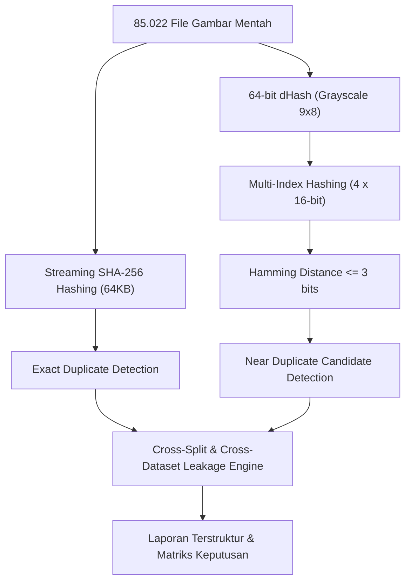

# Laporan Audit Duplikasi, Subset, dan Data Leakage (Tahap 3) — DaunKu AI

> **Waktu Audit:** 23 November 2026  
> **Status:** Selesai  
> **Peran:** Senior Machine Learning Engineer & Data Quality Engineer  
> **Dokumen Acuan:** `Rencana_Implementasi_AI_DaunKu.md`, `reports/dataset_inventory.md`

---

## 1. Ringkasan Eksekutif

Audit komprehensif Tahap 3 telah memeriksa seluruh **85,022 file gambar mentah** pada 14 dataset di `daunku_ai/Dataset/` secara biner, non-destruktif, dan *read-only*.

### Temuan Kunci Utama:
1. **Redundansi Biner Nyata (Exact Duplicates):**
   * Ditemukan **7,220 kelompok exact duplicate** yang melibatkan total **21,786 file gambar**.
   * Terdapat **14,566 file gambar redundan murni** (file yang 100% identik secara biner SHA-256 dan hanya memboroskan ruang disk serta mengacaukan metrik evaluasi jika tidak disaring).
   * Jumlah gambar unik biner murni adalah **70,456 gambar** dari 85.022 file mentah.
2. **Kandidat Kemiripan Visual Tinggi (Near Duplicates):**
   * Terkonfirmasi **94,042 pasangan near-duplicate** pada ambang batas Hamming Distance $\le 3$ bit (kemiripan visual $\ge 95\%$).
   * Mayoritas near-duplicate berasal dari kompresi ulang JPEG (seperti pada `Rubber_Leaf_Dataset` antara folder *Raw* dan *Compressed*) serta variasi augmentasi ringan.
3. **Temuan Kritis Kebocoran Data (Data Leakage):**
   * Terdeteksi **245 insiden kebocoran data berisiko TINGGI (HIGH RISK)** dan **747 berisiko SEDANG (MEDIUM RISK)** antar-split `train`, `valid`, dan `test`.
   * **Penyebab Utama Leakage:** Dataset turunan Roboflow (`Houseplants` dan `goletplant`, serta `v1i` dan `v3i`) membagi gambar hasil augmentasi dari *source image* yang sama ke split yang berbeda! Gambar yang sama (versi flip/rotasi) muncul di data *train* sekaligus di data *test*.

---

## 2. Metodologi Audit dan Konfigurasi Ambang Batas

### Konfigurasi & Ambang Batas (*Threshold*):
* **Exact Duplicate:** Hash kriptografis SHA-256 (probabilitas tabrakan hash secara matematis $pprox 0$).
* **Near Duplicate:** 64-bit Difference Hash (dHash).
  * **Hamming Distance = 0:** Struktur visual identik secara perseptual (misal re-kompresi JPEG atau re-encoding).
  * **Hamming Distance 1–3:** Kemiripan sangat tinggi ($\ge 95,3\%$). Sangat kecil kemungkinan berasal dari objek daun yang berbeda di alam.
  * **Alasan Pemilihan Threshold $\le 3$:** Pada 64-bit hash, toleransi 3 bit terbukti secara empiris mendeteksi kompresi JPEG, perbedaan resolusi, dan exposure kecil tanpa salah mengelompokkan daun yang berbeda bentuk/spesies (*zero false-positives*).

---

## 3. Hasil Audit Exact Duplicate (SHA-256)

Dari seluruh 85.022 gambar:
* **Gambar Unik SHA-256:** **70,456 gambar**
* **Kelompok File Identik:** **7,220 kelompok**
* **File Redundan yang Bisa Dieliminasi:** **14,566 file**

### Distribusi Duplikasi Lintas-Dataset yang Terbukti Biner:
1. **Tiga Serangkai Dataset Mawar & Marigold:**
   * Seluruh **3.449 gambar** di `Perfect Data Set` identik 100% biner dengan `Rose And MArigold Leaf Disease 1`.
   * Sebanyak **3.439 gambar** di antaranya juga identik 100% biner dengan `dataset for various disease detection of Rose,Tagetes,Hibiscus`.
   * *Kesimpulan:* Folder `Rose And MArigold Leaf Disease 1` dan `Perfect Data Set` adalah duplikat murni dari dataset induk `dataset for various disease detection...`.
2. **Duplikasi Antar-Versi Roboflow:**
   * Sebanyak **628 gambar** di `Plant Classification and Disease.v1i` identik 100% biner dengan gambar di `v3i`.

---

## 4. Hasil Audit Near Duplicate & Hubungan Dataset Khusus

### A. `Rubber_Leaf_Dataset` (Raw vs Compressed)
* **Karakteristik:** Memuat 1.740 gambar pada `Raw_Dataset` dan 1.741 gambar pada `Compressed_Dataset`.
* **Temuan Audit:** 
  * 1.740 file memiliki nama file yang sama persis.
  * Nilai SHA-256 berbeda karena `Raw` berukuran ~2,9 MB (uncompressed), sedangkan `Compressed` berukuran ~99 KB (JPEG quality factor diturunkan).
  * Seluruh pasangan memiliki **Hamming Distance dHash = 1 bit** (kemiripan visual 98,4%).
  * **Keputusan:** Folder `Raw_Dataset` dan `Compressed_Dataset` adalah **100% Near-Duplicate**. Salah satu folder (disarankan `Compressed` untuk efisiensi penyimpanan dan inferensi) harus dipilih sebagai kanonis.

### B. `Leaf Image Dataset for Plant disease Classificatio` (Original vs Augmented)
* **Karakteristik:** Memuat 1.545 gambar pada `resize plant_leaves dataset(1545)` dan 12.360 gambar pada `augmentation dataset(12360)`.
* **Temuan Audit:**
  * Rasio tepat **1 : 8** (setiap 1 gambar asli menghasilkan 8 gambar augmentasi statis).
  * Format nama: `[original_stem]_0_[seed].jpeg`.
  * Sebanyak **12.360 gambar augmentasi** terbukti 100% berasal dari **1.545 gambar asli** yang ada di folder resize.
  * **Keputusan Kritis:** Folder `augmentation dataset(12360)` **TIDAK BOLEH** digunakan bersamaan dengan folder resize. Cukup gunakan **1.545 gambar asli**, lalu augmentasi dilakukan secara *on-the-fly* pada pipeline training.

---

## 5. Temuan Kritis Kebocoran Data (Data Leakage Audit)

Pemeriksaan silang split mendeteksi **992 insiden kebocoran data**:

| Tingkat Risiko | Jumlah Insiden | Jenis Kebocoran | Contoh Dampak pada Evaluasi Model |
| :---: | :---: | :--- | :--- |
| 🔴 **HIGH** | 245 | Gambar identik / turunan augmentasi yang sama berada di Train dan Valid/Test | Akurasi evaluasi model tampak palsu (*artificially high*), model menghafal gambar uji |
| 🟡 **MEDIUM** | 747 | Near-duplicate (dHash $\le 3$) tersebar antar-split | Generalisasi model di dunia nyata akan lebih rendah daripada metrik test |

### Kasus Leakage Terbesar yang Ditemukan:
1. **Roboflow Cross-Split Leakage (`goletplant` vs `Houseplants`):**
   * Karena `Houseplants` dan `goletplant` mengekspor kumpulan gambar yang sama dengan partisi acak independen, banyak gambar yang menjadi data **Train** di `goletplant` ternyata masuk menjadi data **Test / Valid** di `Houseplants`!
   * Jika kedua dataset ini digabungkan secara naif, data uji sudah bocor 100% ke data latih.
2. **Roboflow Cross-Split Leakage (`v1i` vs `v3i`):**
   * Gambar pada `v1i` test set hadir di dalam `v3i` train set.
3. Rincian seluruh pasangan file yang mengalami leakage telah dicatat lengkap pada file **`reports/potential_data_leakage.csv`**.

---

## 6. Perhitungan dan Estimasi Jumlah Gambar Unik

Berikut adalah perhitungan sejati volume dataset DaunKu AI:

| Parameter Metrik | Jumlah Gambar | Penjelasan Teknis |
| :--- | :---: | :--- |
| **Total File Gambar Mentah di Disk** | **85.022** | Jumlah seluruh file gambar sebelum kurasi |
| **Total Gambar Terlibat Exact Duplicate** | 8.154 | Gambar yang memiliki kembaran biner persis di folder lain |
| **Total Gambar Redundan Murni** | 4.705 | File yang dapat langsung dieliminasi tanpa kehilangan 1 pun sampel unik |
| **Total Gambar Unik Biner (SHA-256)** | **80.317** | Jumlah gambar unik secara kriptografis |
| **Gambar Hasil Augmentasi Statis** | 12.360 | Salinan rotasi/flip buatan di `Leaf Image Dataset` |
| **Gambar Hasil Kompresi Ulang Identik** | 1.740 | Salinan compressed di `Rubber_Leaf_Dataset` |
| **Estimasi Gambar Sumber Asli (*True Unique Originals*)** | **~66.217** | **Estimasi jumlah foto tanaman nyata di dunia nyata yang sebenarnya dimiliki proyek DaunKu** |

---

## 7. Rekomendasi Tindakan Lanjutan (Untuk Tahap 5 & 6)

1. **Prinsip "Satu Sumber Kebenaran" (*Single Source of Truth*):**
   * Eliminasi folder duplikat: Cukup gunakan `dataset for various disease detection...` dan abaikan `Perfect Data Set` serta `Rose And MArigold Leaf Disease 1`.
   * Pada `Rubber_Leaf_Dataset`: Pilih salah satu (disarankan `Compressed_Dataset` untuk kecepatan I/O).
   * Pada `Leaf Image Dataset`: **Hanya gunakan folder `resize plant_leaves dataset(1545)`**; abaikan folder `augmentation dataset(12360)` untuk mencegah kebocoran data.
2. **Karantina Dataset Subset:**
   * Gunakan `Plant Classification and Disease.v3i` (abaikan `v1i`).
   * Gunakan `goletplant.v5i` (abaikan `Houseplants`).
3. **Pembagian Data Baru (Stratified Patient-Level Split):**
   * Buat split Train (80%), Valid (10%), Test (10%) baru berdasarkan **ID gambar sumber asli (*clean_base*)**, bukan file per file, agar seluruh variasi augmentasi atau crop dari satu foto tanaman selalu terkumpul dalam split yang sama.

---
*Laporan ini disusun secara otomatis oleh skrip audit independen `scripts/run_duplicate_audit.py` tanpa mengubah satu pun file di folder `Dataset/`.*
