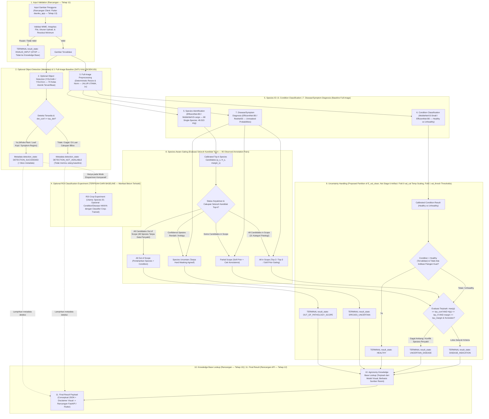

# Rancangan Pipeline AI dan Diagram Alir Sistem (Stage 7 — Final Targeted Revision) — DaunKu AI

> **Tanggal Revisi Final:** 25 November 2026  
> **Status:** Rancangan Pipeline Konseptual — *Not Yet Implemented* (**Belum Ada Model Terlatih / Belum Ada API Aktif**)  
> **Peran:** Senior Machine Learning Engineer, AI Architect, & Computer Vision Specialist  
> **Artefak Acuan:**  
> - `daunku_ai/reports/model_architecture_recommendation.md`  
> - `daunku_ai/reports/baseline_experiment_plan.md`  
> - `daunku_ai/reports/stage7_final_consistency_review.md`  
> - `daunku_ai/artifacts/splits/split_manifest.csv` & `split_summary.json`  
> - `daunku_ai/Rencana_Implementasi_AI_DaunKu.md`

---

## 1. Status Implementasi & Batasan Rancangan

Dokumen ini menyajikan diagram arsitektur dan alur inferensi **konseptual** DaunKu AI (*design recommendation* / *not yet implemented*):
- **Model Terlatih Saat Ini:** **Belum ada (`trained_model_version: null`)**. Seluruh kandidat model (`EfficientNet-B0`, `MobileNetV3-Small`, `MobileNetV3-Large`, `ResNet50`, `YOLOv8n`, `YOLO11n`) baru berstatus rekomendasi eksperimen Stage 8 (`planned_model_version: "0.1.0-planned"`).
- **Komponen Belum Diimplementasikan (Tahap 10–13):** **FastAPI**, **ONNX**, **TFLite**, **Agronomy Knowledge Base**, dan integrasi **Flutter (`daunku_app`)**.
- **Aturan Alur Eksekusi:**
  1. `INVALID_INPUT` **berhenti seketika pada tahap validasi input** dan **tidak diteruskan** ke model maupun Knowledge Base.
  2. **Full-Image Classification Baseline dijalankan tepat SATU KALI** untuk setiap gambar valid.
  3. **Object Detection bersifat opsional (paralel/metadata)**; kegagalan deteksi hanya mengisi metadata `detection_state = DETECTION_NOT_AVAILABLE` dan **tidak pernah memicu eksekusi ulang full-image classifier**.
  4. **Jalur Eksperimen ROI terpisah total dari baseline utama** (manfaat ROI **belum terbukti**; hanya diuji sebagai eksperimen komparatif untuk Species Identification — dan opsional Condition/Disease hanya bila classifier terpisah dilatih secara konsisten pada ROI crop untuk mencegah *distribution shift*).

---

## 2. Diagram Alir Pipeline Lengkap (Conceptual System Flowchart)

Diagram berikut memisahkan secara tegas **Jalur Baseline Utama (Full-Image, satu kali eksekusi)**, **Jalur Metadata Deteksi Opsional**, dan **Jalur Eksperimen ROI Terpisah**, serta memisahkan **6 Terminal `result_state`** dari **Metadata `detection_state`**.



---

## 3. Diagram Sekuen Konseptual (Conceptual Sequence Diagram)

```mermaid
sequenceDiagram
    autonumber
    actor User as Pengguna
    participant App as Flutter Client [Rancangan — Tahap 13]
    participant API as FastAPI Service [Rancangan — Tahap 12]
    participant Pipe as Inference Pipeline [Rancangan — Tahap 11]
    participant Models as Models (Planned v0.1.0, Belum Dilatih)
    participant Gate as Species-Aware Gating & Uncertainty Engine
    participant KB as Agronomy Knowledge Base [Rancangan — Tahap 10]

    User->>App: Unggah / ambil foto tanaman
    App->>API: POST /predict (atau /api/v1/diagnose) [Kontrak Konseptual]
    activate API
    API->>Pipe: 1. Input Validation (MIME, integritas, ukuran)
    alt File tidak valid
        Pipe-->>API: Terminal result_state: INVALID_INPUT (berhenti di validasi; tidak ke KB)
        API-->>App: 422 Unprocessable Entity (Conceptual)
    else File valid
        par 2. Optional Object Detection (Metadata)
            Pipe->>Models: Detektor opsional (YOLOv8n / YOLO11n, cek det_conf >= tau_det)
            Models-->>Pipe: detection_state (DETECTION_SUCCEEDED / DETECTION_NOT_AVAILABLE) + bbox opsional
        and 3. Full-Image Baseline (Satu Kali Eksekusi)
            Pipe->>Models: 5. Species ID, 6. Condition, 7. Disease/Symptom (full-image, 1x pass)
            Models-->>Gate: Calibrated distributions (Top-k species, condition, unmasked disease)
        end

        Gate->>Gate: 8. Evaluasi seluruh kandidat Top-k (All/Some/Out-of-Scope/Uncertain)
        Gate->>Gate: 9. Cek 3 metrik terpisah (Confidence, Entropy, Margin) & konsistensi
        Gate-->>Pipe: Terminal result_state (pertahankan Species & Condition walau Disease out-of-scope)

        Pipe->>KB: 10. Lookup panduan perawatan & disclaimer berbasis sumber resmi
        KB-->>Pipe: Teks panduan terverifikasi (atau instruksi observasi ulang)
        Pipe-->>API: 11. Final Result (Conceptual JSON: terminal result_state + metadata detection_state)
        API-->>App: 200 OK (Conceptual Response)
    end
    deactivate API
```

---

## 4. Pemisahan Resmi Status: Terminal `result_state` vs Metadata `detection_state`

### A. Terminal `result_state` (6 Status Diagnosis Terminal)

| Terminal `result_state` | Kapan Diterbitkan | Diteruskan ke Knowledge Base? | Informasi yang Ditampilkan |
| :--- | :--- | :---: | :--- |
| **`INVALID_INPUT`** | File rusak, format tidak didukung, atau tidak memenuhi syarat input. | **TIDAK (Berhenti di Validasi Input)** | Pesan error validasi & instruksi unggah ulang. |
| **`SPECIES_UNCERTAIN`** | Keyakinan identifikasi spesies di bawah ambang validasi (confidence rendah / entropy tinggi / margin sempit). | Ya (panduan foto ulang) | Kandidat Top-$k$ spesies beserta skor + **hasil Condition Classification (jika valid)**. Tanpa *hard masking* agresif. |
| **`OUT_OF_PATHOLOGY_SCOPE`** | Seluruh kandidat Top-$k$ spesies berada di luar 21 kategori berlabel penyakit (48 spesies tanpa data penyakit aktif). | Ya (penjelasan batas cakupan) | **Tetap tampilkan hasil Species ID (jika yakin) dan Condition Classification (jika tersedia)** + penjelasan diagnosis penyakit belum didukung data. |
| **`HEALTHY`** | Condition Classification terkalibrasi memprediksi `Healthy` di atas ambang validasi dan tidak ada indikasi patogen kuat. | Ya (perawatan preventif umum) | Species ID, Condition (`Healthy`), dan skor terkalibrasi. |
| **`UNCERTAIN_DISEASE`** | Kondisi tidak sehat/ambigu, namun gagal salah satu ambang uncertainty (confidence / entropy / margin) atau terjadi konflik spesies–penyakit. | Ya (panduan observasi ulang) | Species ID, Condition, dan kandidat gejala untuk observasi visual; **abstain** dari diagnosis spesifik & hindari saran kimiawi. |
| **`DISEASE_INDICATION`** | Lolos seluruh kriteria kalibrasi, konsistensi spesies–penyakit, dan ambang uncertainty. | Ya (panduan penanganan + disclaimer) | Species ID, Condition (`Unhealthy`), indikasi penyakit/gejala, alternatif kandidat, & disclaimer visual. |

### B. Metadata `detection_state` (Bukan Terminal `result_state`)

| Metadata `detection_state` | Makna | Pengaruh pada Full-Image Baseline |
| :--- | :--- | :--- |
| **`DETECTION_SUCCEEDED`** | Detektor opsional menemukan objek dalam cakupan 70 kelas atomik terverifikasi dengan `det_conf >= tau_det`. | Menyediakan metadata koordinat boks; baseline full-image tetap berjalan 1x (ROI hanya pada mode eksperimen terpisah). |
| **`DETECTION_NOT_AVAILABLE`** | Detektor tidak menemukan objek (`det_conf < tau_det`), gagal, atau gambar di luar cakupan anotasi boks. | **Tidak memblokir dan tidak memicu eksekusi ulang** full-image baseline. |
| **`DETECTION_SKIPPED`** | Modul deteksi opsional tidak diaktifkan pada konfigurasi inferensi. | Baseline full-image tetap berjalan normal 1x. |

---

## 5. Contoh Kontrak JSON Konseptual (*Illustrative Only — Not Live API*)

> [!WARNING]
> **Kontrak Konseptual & Ilustratif:** Contoh di bawah ini bukan respons dari model terlatih maupun endpoint API aktif (`trained_model_version: null`). Catatan: pasangan `Tomato (Solanum lycopersicum)` + `Early Blight (Alternaria solani)` memang terverifikasi terdapat dalam anotasi manifest aktif (204 gambar: Tr 142 / Val 31 / Te 31), **namun contoh payload di bawah ini semata-mata ilustrasi format skema, bukan bukti bahwa aplikasi atau model sudah mendukung diagnosis tersebut**. Seluruh catatan perawatan kimiawi hanya ilustrasi yang wajib diverifikasi terhadap sumber agronomi resmi dan regulasi setempat pada Tahap 10.

### 5.1 Contoh Ilustratif: `OUT_OF_PATHOLOGY_SCOPE` (Dengan Metadata `detection_state` Terpisah)

```json
{
  "status": "info",
  "schema_status": "conceptual_illustrative_draft_not_live",
  "planned_model_version": "0.1.0-planned",
  "trained_model_version": null,
  "pipeline_mode": "full_image_baseline",
  "result_state": "OUT_OF_PATHOLOGY_SCOPE",
  "detection_metadata": {
    "detection_state": "DETECTION_NOT_AVAILABLE",
    "bbox": null
  },
  "species": {
    "top_k_candidates": [
      { "species_label": "Coffee (Coffea)", "calibrated_confidence": 0.92 }
    ],
    "scope_evaluation": "all_candidates_out_of_pathology_scope"
  },
  "condition": {
    "available": false,
    "note": "Dataset Kopi berlabel 'leaf' (kondisi Unknown), sehingga kondisi tidak diasumsikan Healthy."
  },
  "pathology": {
    "indication_label": null,
    "reason": "Diagnosis penyakit untuk spesies ini belum didukung oleh data pelatihan berlabel."
  },
  "knowledge_base": {
    "status": "planned_stage10_not_implemented",
    "message": "Spesies teridentifikasi, namun diagnosis penyakit belum tersedia untuk cakupan spesies ini."
  },
  "disclaimer": "Contoh format ilustratif konseptual; model belum dilatih dan API belum aktif."
}
```

### 5.2 Contoh Ilustratif: `DISEASE_INDICATION` (Contoh Format Tomato / Early Blight)

```json
{
  "status": "success",
  "schema_status": "conceptual_illustrative_draft_not_live",
  "planned_model_version": "0.1.0-planned",
  "trained_model_version": null,
  "pipeline_mode": "full_image_baseline",
  "result_state": "DISEASE_INDICATION",
  "detection_metadata": {
    "detection_state": "DETECTION_NOT_AVAILABLE",
    "bbox": null
  },
  "species": {
    "top_k_candidates": [
      { "species_label": "Tomato (Solanum lycopersicum)", "calibrated_confidence": 0.90 },
      { "species_label": "Potato (Solanum tuberosum)", "calibrated_confidence": 0.06 }
    ],
    "scope_evaluation": "all_candidates_in_pathology_scope"
  },
  "condition": {
    "available": true,
    "predicted_state": "Unhealthy",
    "calibrated_healthy_prob": 0.05,
    "calibrated_unhealthy_prob": 0.95
  },
  "pathology": {
    "indication_label": "Early Blight (Alternaria solani)",
    "example_note": "Contoh ilustratif skema (pasangan teramati 204 gambar di manifest aktif; bukan bukti kemampuan model terlatih).",
    "gating_experiment_mode": "top_k_soft_prior",
    "uncertainty_metrics": {
      "calibrated_confidence": 0.82,
      "predictive_entropy": 0.58,
      "top1_top2_margin": 0.69
    }
  },
  "knowledge_base": {
    "status": "planned_stage10_not_implemented",
    "treatment_note": "Ilustrasi saja. Seluruh rekomendasi perawatan, khususnya bahan kimia/pestisida, wajib diverifikasi terhadap sumber agronomi resmi dan peraturan penggunaan setempat pada Tahap 10."
  },
  "disclaimer": "Hasil merupakan indikasi visual konseptual, bukan diagnosis pasti. Gejala visual yang mirip dapat memiliki penyebab berbeda."
}
```

---

## 6. Revision Notes (Final Targeted Revision — 25 Nov 2026)

- **Temuan Review:** Pada diagram sebelumnya, `INVALID_INPUT` masih terhubung ke Knowledge Base; alur `DETECTION_NOT_AVAILABLE` terhubung kembali ke `BASE_FULL` yang berpotensi disalahartikan sebagai eksekusi ganda full-image classifier; `DETECTION_NOT_AVAILABLE` tercampur dengan terminal `result_state`; serta batas cakupan eksperimen ROI dan status ilustratif contoh Tomato/Early Blight perlu dipertegas.
- **Perubahan:** Memutus `INVALID_INPUT` di Layer 1 (berhenti sebelum KB); membuat full-image baseline berjalan tepat satu kali secara paralel dengan jalur metadata deteksi opsional; memisahkan secara tegas **6 Terminal `result_state`** dari **Metadata `detection_state`**; memperjelas batas eksperimen ROI sebagai jalur terpisah dengan manfaat belum terbukti; serta menandai contoh Tomato/Early Blight secara eksplisit sebagai contoh ilustratif.
